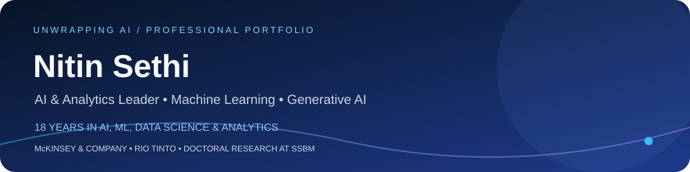
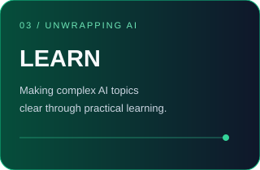
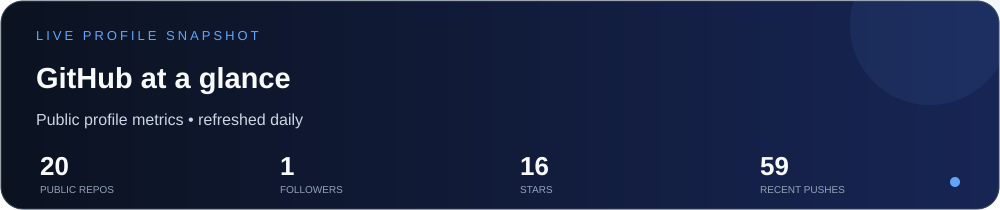

## About

I work at the intersection of **Artificial Intelligence, Data Science and business problem-solving**. I enjoy turning complex ideas into practical systems — from predictive models and analytics solutions to LLM applications and AI agents.

- Building practical AI projects and learning resources through **Unwrapping AI**
- Exploring transformers, LLMs, RAG, agentic AI and applied machine learning
- Interested in responsible, useful AI that solves real business problems
- Sharing hands-on notebooks, experiments and explanations with the community

## Three worlds. One curiosity.

  
  
  

## Technology stack

 

## Featured work

| Project | What you'll find |
|---|---|
| [Zero to Transformer](https://github.com/MeNitinsethi/Zero-to-transformer) | A practical, step-by-step journey into transformer architectures |
| [LLM](https://github.com/MeNitinsethi/LLM) | Hands-on large language model learning and experiments |
| [RAG Techniques](https://github.com/MeNitinsethi/RAG_Techniques) | Retrieval-augmented generation concepts and implementations |
| [GenAI Agents](https://github.com/MeNitinsethi/GenAI_Agents) | Agentic AI learning and experimentation |
| [Computer Vision](https://github.com/MeNitinsethi/Computer-vision) | Computer vision notebooks and projects |
| [Credit Card Fraud Detection](https://github.com/MeNitinsethi/Credit-Card-Fraud-Detection) | Applied machine learning for fraud detection |

## GitHub activity

  
  

  Profile cards refresh automatically every day through GitHub Actions.

## Let's connect

If you're working on applied AI, data science, LLMs or practical learning initiatives, I'd be happy to connect and exchange ideas.

  <a href="https://www.linkedin.com/in/nitin-r-sethi/">LinkedIn</a> ·
  <a href="https://github.com/MeNitinsethi">GitHub</a>

