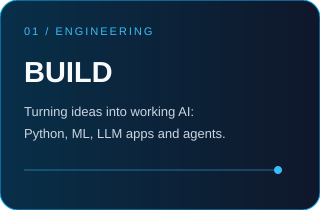
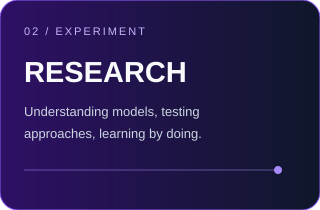
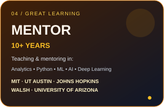
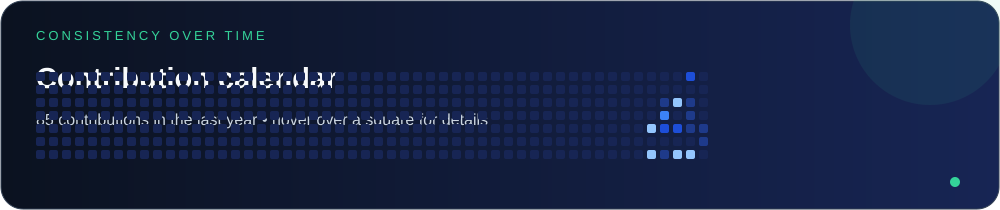

**AI & Analytics Leader ·Mentor· Machine Learning · Generative AI · Data Science**

*Riyadh, Saudi Arabia*

## About me

I am an Artificial Intelligence and Analytics leader with **18 years of experience across machine learning, artificial intelligence, data science and data analytics**. My work focuses on turning complex data into practical products, predictive systems and decision intelligence that help organisations make better decisions.

I bring over **10+ years of experience in teaching, mentoring and training students and working professionals** across Machine Learning, Artificial Intelligence, Data Science, Neural Networks, Deep Learning, Data Analytics and Data Visualisation. Through my association with **Great Learning**, I have mentored learners from leading global universities and academic programmes, including **MIT, UT Austin, Johns Hopkins University, Walsh and the University of Arizona**, among others. My teaching expertise spans hands-on implementation using **Python, R, SQL, Excel, VBA, Power BI, n8n, RapidMiner, KNIME and Databricks**, along with a wide range of Python libraries and machine learning frameworks. I focus on bridging theoretical concepts with practical industry applications, helping learners build real-world skills in AI, analytics, automation and intelligent systems.

I have worked across consulting, mining and financial services, including **McKinsey & Company** and **Rio Tinto**, leading analytics and machine-learning initiatives, building cross-functional teams, and translating business challenges into measurable technology solutions. My experience spans enterprise AI transformation, predictive modelling, deep learning, NLP, workforce and customer analytics, data engineering, and executive decision support.

I am currently pursuing a **Doctorate in Artificial Intelligence at the Swiss School of Business and Management (SSBM), Geneva**. I also completed an AI and Machine Learning programme at **IIT Guwahati**. Alongside industry work, I teach and mentor professionals in machine learning, deep learning, NLP and Generative AI through professional and executive-education programmes, including programmes associated with MIT and The University of Texas at Austin.

I created **Unwrapping AI** to make complex data and AI concepts easier to understand through practical explanations, notebooks and projects. I believe the best way to learn AI is to build, test, question and improve real things.

## Career at a glance

  
  
  
  

- **18 years** across AI, machine learning, data science and analytics
- **McKinsey & Company** — Senior Solution Analyst; analytics and machine-learning consulting
- **Rio Tinto** — Associate Manager, Analytics, ML & AI; predictive modelling, NLP, analytics leadership and MLOps
- **AI leadership in Saudi Arabia** — enterprise AI transformation, decision support and analytics platforms
- **10+ years** teaching and mentoring in AI/ML, deep learning, NLP and Generative AI

## What I work on

| Area | Focus |
|---|---|
| Artificial Intelligence | Enterprise AI strategy, applied AI, decision intelligence and AI transformation |
| Machine Learning | Predictive modelling, supervised and unsupervised learning, segmentation and risk scoring |
| Deep Learning & NLP | Neural networks, transformers, BERT, sentiment analysis and language applications |
| Generative AI | LLMs/SLMs, fine-tuning, prompt engineering, RAG and AI applications |
| Agentic AI | AI agents, orchestration, tool use, verification and workflow automation |
| Data & Analytics | Data strategy, analytics engineering, forecasting, workforce analytics and executive dashboards |
| MLOps & Engineering | Model lifecycle, deployment, monitoring, APIs and scalable data pipelines |

## Selected work and experience

- **Enterprise AI and decision intelligence:** building AI-enabled platforms, predictive insights and recommendation layers to help decision-makers interpret complex signals.
- **Healthcare analytics:** predictive clinical-risk modelling, cohort analytics, diagnostic insights and decision-support approaches across healthcare settings.
- **Workforce analytics:** BERT-based employee sentiment analysis, predictive attrition and workforce-demand models.
- **Industrial and financial analytics:** analytics transformation, automated reporting, operational insights, risk modelling and executive decision support.
- **AI engineering:** practical work with Python, cloud data platforms, MLOps, LLM applications and agentic workflows.

## Technology

 

**Languages & data:** Python, R, SQL/T-SQL, VBA, Spark, Kafka, DuckDB  
**AI/ML:** PyTorch, TensorFlow, scikit-learn, Hugging Face, LangChain, NLP, deep learning, LLM/SLM fine-tuning  
**MLOps & deployment:** MLflow, Docker, Kubernetes, Airflow, FastAPI  
**Cloud & platforms:** Azure Data Factory, Synapse, AWS SageMaker, Redshift, S3, GCP Vertex AI, BigQuery, Snowflake, Databricks  
**Analytics & BI:** Power BI, Tableau, Looker Studio, Spotfire, D3  
**Databases & automation:** SQL Server, PostgreSQL, MySQL, MongoDB, Teradata, Alteryx, Power Automate, n8n

## Featured projects

| Repository | Overview |
|---|---|
| [Zero to Transformer](https://github.com/MeNitinsethi/Zero-to-transformer) | A practical learning journey through transformer architectures |
| [LLM](https://github.com/MeNitinsethi/LLM) | Hands-on large language model learning and experiments |
| [RAG Techniques](https://github.com/MeNitinsethi/RAG_Techniques) | Retrieval-augmented generation concepts and implementations |
| [GenAI Agents](https://github.com/MeNitinsethi/GenAI_Agents) | Agentic AI learning and experimentation |
| [Computer Vision](https://github.com/MeNitinsethi/Computer-vision) | Computer vision notebooks and projects |
| [Credit Card Fraud Detection](https://github.com/MeNitinsethi/Credit-Card-Fraud-Detection) | Applied machine learning for fraud detection |

## Education & professional development

- **Doctorate in Artificial Intelligence — pursuing**, Swiss School of Business and Management (SSBM), Geneva
- **AI / Machine Learning Programme**, IIT Guwahati
- **Bachelor of Arts**, Indira Gandhi National Open University (IGNOU)
- Google Cloud Data Analytics Professional Certificate
- Generative AI for Developers and Cloud Engineer learning paths — Google
- SAFe Scrum Master — Scaled Agile

## Teaching, mentoring & knowledge sharing

For **10+ years**, I have been teaching and mentoring learners and working professionals in **Data Analytics, Data Visualisation, Python, Machine Learning, Artificial Intelligence, Deep Learning, Neural Networks and Generative AI**. I have worked with **Great Learning for around a decade**, supporting learners through structured learning journeys, practical assignments and applied projects.

Through Great Learning programmes, I have mentored learners associated with universities and institutions including **MIT, The University of Texas at Austin, the University of Arizona, Walsh University and College, and Johns Hopkins University**, among others. These are mentoring engagements connected with educational programmes—not claims of employment by, or formal faculty appointments at, those universities.

My approach is practical: explain the concept, work through the data, build the model, evaluate the result and understand how it can be used responsibly in a real setting.

## Current areas of exploration

- **LLM adaptation and fine-tuning:** experimenting with open and pre-trained language models, fine-tuning approaches, evaluation and task-specific adaptation.
- **Dataset preparation and experimentation:** exploring datasets, cleaning and structuring data, preparing training/evaluation splits, and testing model behaviour.
- **Generative AI applications:** working with LLMs/SLMs, retrieval-augmented generation (RAG), prompt design and practical AI applications.
- **Workflow automation:** designing and building multi-step automations with **n8n**, connecting APIs, data sources, AI models and business processes.
- **Agentic workflows:** experimenting with tool-using agents, orchestration, verification and human-in-the-loop patterns.
- **Hands-on learning:** turning experiments into notebooks, demonstrations and learning material through **Unwrapping AI**.

## GitHub activity

  
  
  Profile metrics and contribution cards are refreshed automatically by GitHub Actions.

## Connect

I welcome conversations around enterprise AI, applied machine learning, Generative AI, data strategy, AI leadership, mentoring and practical learning.

